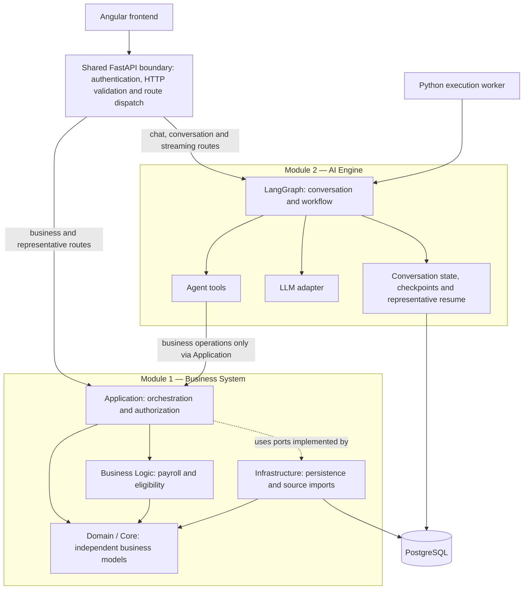

# Strauss Vehicle Advisor
## Architecture and Implementation Specification

**Architecture version:** 2.2 — Python-only backend; aligned with Agent Specification v1.4  
**English edition:** 1.0, 14 October 2026  
**Status:** implementation specification for the challenge demonstration; not a certified payroll system.

This document is the technical architecture companion to `agent-spec.md` v1.4, not a competing source of business or conversation policy. It is also the English counterpart of the earlier Hebrew Python-only specification. It consolidates the architecture, proposed files, data contracts, demonstration calculations, conversational workflow, persistence, and acceptance criteria. File paths describe proposed implementation units, not existing application code. Source requirements and explicit design decisions must remain distinguishable.

Hebrew conversation examples and the original challenge files remain in their original language. Do not infer additional payroll or eligibility rules from this translation. If a contradiction is discovered between editions, record and resolve it explicitly rather than choosing whichever text is convenient.


> **Parallel implementation integration note (2026-10-15):** `integration-contracts.md` v1.0 defines cross-team tool/API boundaries and the contract-first gate. It does not supersede the approved business decisions in `agent-spec.md` v1.4. The earlier Angular frontend Amendment A is **not accepted as written**: its last-write-wins updates and 30-day purge are rejected. Expanded actual EmployeeProfile fields are approved only as specified in the 2026-10-15 implementation update below. See the integration contracts before generating TypeScript or Python schemas.

## 1. Scope and non-negotiable boundaries

Build a Hebrew conversational advisor that lets an employee:

- Browse vehicles allowed by their eligibility group.
- Calculate estimated monthly net pay for one or all eligible alternatives.
- Compare alternatives against their current company car or vehicle-maintenance allowance.
- Correct previously supplied details during the same conversation.
- Request a transportation representative's answer when a required business fact is unknown.
- Refresh or disconnect without losing saved progress.
- In a future release, optionally upload a fictional payslip or contract for extraction and review; document upload is **not** implemented in the initial demo.

The entire backend is Python. Angular remains the frontend. Business calculations must be deterministic Python code using `Decimal`. The LLM understands language, proposes structured updates, selects allowed tools, and explains verified results. It must not calculate payroll, invent amounts, grant eligibility, or access the ORM directly.

The actual employee facts belong to one versioned, employee-owned **latest employee profile** shared across conversations: six salary fields plus occupation, entitlement group, qualifying child count, and last-reported current arrangement and its relevant amounts. A new conversation starts a separate case initialized from the employee profile; only alternatives, hypothetical overrides, requests, messages, and results are case-specific. Refreshing resumes the same case. Historical results keep immutable input snapshots; hypothetical salary changes remain conversation/scenario scoped and never overwrite the employee profile. Authorization binds profile and cases to the authenticated employee, not model-chosen IDs.

The demonstration uses fictional challenge data and illustrative 2025 payroll tables together with the 2026 vehicle benefit-in-kind dataset. It does not implement annual cumulative payroll, special insurance categories, unspecified credits, or undisclosed employer policies.

`SpecificationReady` means that the implementation contract is defined. `DemoValidated` means that the actual implementation passed its tests. Independent reference calculations are not a substitute for testing the application.

## 2. Architecture and runtime topology



**Canonical module boundary and shared API (approved architecture):** The Python backend has exactly **two functional modules**: **Business System** (the four layers **Application**, **Business Logic (BL)**, **Domain / Core**, and **Infrastructure**) and **AI Engine** (LangGraph conversation/workflow, agent tools, LLM adapter, persisted conversation state and representative-answer continuation). **One shared FastAPI boundary sits outside both modules**, authenticates and validates incoming Angular requests, and dispatches them by route: business, catalogue, calculation and representative endpoints to Business Application; chat, conversations and streaming endpoints to the AI workflow entry point. Internal agent-to-business calls go **only through the Business Application services**, never directly to BL, Core functions, repositories, ORM or PostgreSQL. The API is a transport boundary, not a third business module. API/worker/bootstrap are runtime entry points and wiring, not extra functional modules. The existing **Application–Infrastructure dependency-inversion/ports-and-adapters design remains unchanged**; this clarification does not create mutual direct imports or alter other dependency rules.

This is one modular backend application, one Python package, and one backend image with API and worker entrypoints. Layers are modules, not independently deployed network services. Agent tools call application services directly through Python contracts. There is no internal business REST client and no second-language backend.

The API persists incoming conversation inputs before acknowledging them. The worker executes the graph after commit. Representative answers and durable resume inputs are saved in the same PostgreSQL transaction. A separate HTTP delivery mechanism, outbox dispatcher, and duplicate inbox are unnecessary for this topology.

### Dependency rules

| Layer | Responsibility | Permitted dependencies |
| --- | --- | --- |
| API | HTTP requests, DTOs, authentication, responses, SSE | Application; bootstrap wiring |
| Application | Use cases, resource authorization, completeness, transactions | Domain, Business Logic, application-owned ports |
| Business Logic | Eligibility, benefit calculations, payroll, scenario construction | Domain and standard library; no ORM, HTTP, or LLM |
| Domain | Business concepts, values, configuration, results, local invariants | Python standard library; no framework dependency |
| Agent | Conversation, graph, tools, clarification, waiting | Application, Domain, adapter contracts; no ORM |
| Infrastructure | Persistence, imports, checkpoints, identity and external-model adapters | Implements Application/Agent ports; uses Domain models |
| Bootstrap and Worker | Component wiring and execution | Other layers for composition only |

Domain replaces the earlier Core responsibility. Application handles orchestration; Business Logic contains policies and algorithms. Pydantic is used at boundaries. SQLAlchemy persistence models are not Domain models.

Application depends on a `GraphRunner` port; the Agent provides its LangGraph implementation. Bootstrap connects them. Application must not import the concrete workflow and create a dependency cycle.

## 3. Persistence and ownership

PostgreSQL contains `business`, `agent`, and `auth` schemas in one database. Schemas express module ownership, not separate backend services. Business repositories own business data; agent stores own conversation and execution data. A Unit of Work can save a representative answer and an agent input atomically through their implementations using the same SQLAlchemy session.

The agent state may contain contextual copies and last-known versions. Application-owned business data remains authoritative. Checkpoints are the authoritative graph execution state; message history is the authoritative display history. The latest actual salary profile is authoritative for new regular calculations, while immutable calculation snapshots are authoritative for historical results. Neither agent checkpoints nor message history is a substitute salary database.

Use a separate migration identity from runtime identities. The Agent receives services, not unrestricted database access. Do not share an `AsyncSession` across concurrent tasks or hold a business transaction open during an LLM call.

## 4. Project layout conventions

Backend paths in the file map are relative to `src/backend/`. The main package is `app`. Frontend paths are relative to `src/frontend/`. Root tooling paths are relative to the repository root.

Use `__init__.py` where needed. Avoid import-time side effects. Several small related types may share one module; a separate class or wrapper for every function is not required. Lock dependency versions when scaffolding the project.

The file map is provided in Appendix A. Its descriptions define ownership; code boundaries must be tested, not merely implied by directory names.

## 5. Business requirements versus demonstration policies

| Decision | Basis |
| --- | --- |
| Choose the employee's group or a lower group; unused budget is not paid as salary | Challenge PDF and JSON |
| Family track: at least four qualifying children, catalogue-specific vehicle cost, 50% gap share | Updated JSON and workbook |
| Maintenance allowance is taxable and not pensionable | JSON and workbook |
| Employee pension and study-fund contributions use base salary + commissions + bonus | Updated JSON; demonstration simplification |
| Employee participation is a net deduction and does not reduce benefit-in-kind | Updated JSON |
| Electric benefit targets ILS 250 net through gross-up | Updated JSON |
| Family-track ordinary participation is additional to the gap contribution | Explicit demonstration policy supported by E-002; encode it separately |
| Maintenance and electric reimbursements are excluded from contribution bases | Interpretation of the stated contribution base, supported by the reference results |
| Maintenance and gross-up amounts enter the insurance base in the demonstration | Reconstructed demonstration policy matching the reference results; make it explicit |
| Count qualifying children through age 23 (before their 24th birthday) | Approved decision in Agent Specification v1.4; the source JSON wording alone is not mathematically explicit about the birthday boundary |
| Never invent salary facts or eligibility | Challenge requirement |
| Ineligible is a business result; unknown is not zero | Design decision |

Preserve source files unchanged. Create an explicit derived policy snapshot, such as `derived-demo-v1`, containing source hashes and decisions including:

- `familyParticipationMode=base_plus_gap`
- `allowanceInsurable=true`
- `grossUpInsurable=true`
- `contributionsExcludeVehicleBenefits=true`
- `childAgeComparison=age_less_than_24`

These are not fields that the organizers supplied verbatim. Do not misattribute them to the source JSON or present them as approved real payroll rules.

### Source inconsistencies

1. The CSV propulsion header conflicts with the JSON mapping and catalogue examples. For catalogue demonstration vehicles, use the supplied catalogue propulsion category and retrieve benefit-in-kind through the precise CSV key. Do not classify the entire dataset from the contradictory header. For a non-catalogue current vehicle, require a sufficiently verified propulsion category if it affects the calculation.
2. The catalogue lacks vehicle-type codes. A type-1 record matching the workbook value was found for each of CAR-01 through CAR-20. Encode these individual mappings as documented demonstration import decisions. Do not default every unknown vehicle to type 1. ATTO 3 has two matches with different values when vehicle type is omitted.
3. The workbook introduction says 20 regular vehicles plus 2 family vehicles; actual rows contain 18 regular vehicles plus 2 family vehicles. Import the 20 actual rows and retain an import warning.
4. Two source JSON editions share the same `version` string. Identify snapshots using both the supplied version and a SHA-256 content hash.

The CSV has 77,988 records and 19 columns; the complete five-part business key had no duplicates in the supplied file. This source check does not authorize guessing omitted identifiers.

## 6. Data formats and supported limits

| Type | Contract |
| --- | --- |
| Internal identifiers | UUID |
| Catalogue identifiers | Opaque strings, e.g. `CAR-10` |
| JSON money | Decimal string, e.g. `"18500.00"`; no thousands separators |
| Calculation money | `Decimal`; never construct it through a binary float |
| Rate | Decimal string from 0 to 1; `"0.06"` means 6% |
| Credit points | Nonnegative decimal string |
| Calculation month | `YYYY-MM` |
| Effective/reference date | `YYYY-MM-DD`; default reference date is the first day of the selected month |
| Technical timestamp | UTC ISO-8601; localize only for display |
| Manufacturer/model code | String retaining leading zeros; match the source, do not coerce to integer |
| Unknown field | `value=null`, `status=missing`; not zero. Additional field statuses: `needs_clarification`, `usable` |
| Employee estimate | Keep `status=needs_clarification` until explicitly agreed for a hypothetical scenario; then use `status=usable` with assumption provenance in that scenario only |
| Provenance | `employee`, `catalogue`, `rules`, `tax_dataset`, `representative`; `document_confirmed` is future-only. Server establishes source and source message reference |

Configurable demonstration support limits, not eligibility laws: 8,000 characters per message; 30 alternatives per run; input amounts up to ILS 1,000,000 per month; up to 100 credit points and 100 children. Reject unsupported values with `INPUT_OUT_OF_SUPPORTED_RANGE`; never silently clamp them.

Zero contribution rates are valid. Zero base salary is mathematically supported and must not become a default value. If it requires clarification, surface that explicitly. Other deductions are not independently supported by the initial agreed calculator contract. If an employee mentions an additional deduction or unsupported component, clarify and disclose that the demo estimate is incomplete rather than silently treating it as zero or introducing unapproved tax handling. An extension requires an explicit rule and tests.

## 7. Business case models

| Model | Fields |
| --- | --- |
| ComparisonCase | `caseId`, `conversationId`, `ownerSubjectId`, `calculationMonth`, `referenceDate`, `caseVersion`, `lifecycleStatus`, timestamps |
| EmployeeDetails | `occupationId`, `entitlementGroup`, `qualifyingChildrenCount`; field status and provenance |
| PayrollDetails | Case-local resolved values from the current actual salary profile, or explicitly scoped hypothetical overrides: `baseGross`, `commissionsGross`, `bonusGross`, `pensionEmployeeRate`, `studyFundEmployeeRate`, `creditPoints` |
| CurrentArrangement | `kind=company_car`, `allowance`, or `no_car_no_allowance`; actual vehicle reference, actual participation, family deduction inclusion flag, or allowance amount as applicable |
| Alternative | `alternativeId`, `alternativeVersion`, `active`, `kind`, `track`, vehicle or waiver selection; approved participation override |
| FieldProvenance | `fieldPath`, `sourceType`, `sourceReference`, `observedAt`, `confirmationStatus` |
| VehicleTaxKey | `taxYear`, `registrationYear`, `vehicleTypeCode`, `manufacturerCode`, `modelCode` |
| PayrollCalculationInput | `earnedGross`, `taxableCashAdditions`, `valueOfUse`, contribution bases, rates, credits, ordinary participation, family deduction, and rules snapshot reference; no arbitrary additional deduction in initial demo |

Reported actual occupation, entitlement group, qualifying children, and current arrangement are also sourced from the versioned latest employee profile; requested scenarios remain case-specific. The employee never types the authenticated actor identifier. Resolve references such as “the first option” against the actual displayed selection and persist the resulting alternative ID.

If both occupation and group are supplied and conflict with the demonstration occupation table, report a conflict and clarify or request a representative answer. Do not overwrite the employee's group automatically. Occupation is required for waiver checks, not necessarily for regular catalogue browsing.

`PayrollDetails` may be partial. `PayrollCalculationInput` must be complete. A scenario builder returns a complete input or explicit missing/conflicting facts; it never turns missing facts into zeros.

### 7.1 Shared salary-profile and hypothetical-state contract (approved)

`business.employee_profiles` is keyed by the server-authenticated employee. It stores six actual salary fields plus occupationId, entitlementGroup, qualifyingChildrenCount, and reported currentArrangement details: `baseGross`, `commissionsGross`, `bonusGross`, `pensionEmployeeRate`, `studyFundEmployeeRate`, `creditPoints`. Every field has `value`, `status`, `source`, `sourceMessageId`, `updatedAt` and `revision`; the profile has `version`. Missing is not zero. These actual fields are shared; their hypothetical overrides and conversation-specific confirmations are case-local. Reported current vehicle information must be rechecked only when relevant to a current-baseline calculation.

When creating a conversation/case, copy the current actual salary values and `salaryProfileVersionUsed` into its editable working state; do not copy hypothetical values. On resuming an older conversation, expose any mismatch between saved and latest profile versions. For a **new regular calculation**, synchronize the case's actual salary fields to the latest profile under an optimistic transaction, leaving prior messages and calculation snapshots intact. For **view previous result**, return the historical snapshot without recalculation. Hypothetical checks retain a scenario-local override (and fixed baseline when applicable); they never mutate the latest actual salary profile. A spoken correction is actual only when intent is clear; ambiguous actual-versus-hypothetical statements require clarification.

One calculation snapshot includes salary amounts, relevant non-salary facts, current arrangement, selected alternatives, source versions, case/profile version used and `kind=regular|hypothetical`. Never present an obsolete result as current. The application, not the LLM or LangGraph state, enforces atomic profile/case writes and optimistic version conflicts. Historical profile changes can be reconstructed only insofar as preserved messages and calculation snapshots allow; do not promise an independent complete profile-change audit without implementing one.

### 7.2 Initial-scope boundaries

The initial demo accepts typed employee fields only. There is no upload, document extraction, inferred credit points or arbitrary extra-deductions engine. The wider architecture may retain future-only module diagrams/file-map entries, but neither frontend nor coding agent should present them as working initial features. Keep the family birthday decision explicit: a child aged 23 qualifies until the 24th birthday; ask for the number of children who have not yet turned 24.

## 8. Case updates and versioning

`PATCH /api/v1/cases/{caseId}` receives `expectedCaseVersion`, `expectedProfileVersion` when changing actual salary, `mode` (`actual_update` or `hypothetical`), `operationId`, and a restricted list of `set` or `clear` operations. It is not unrestricted JSON Patch over server objects.

```json
{
  "expectedCaseVersion": 3,
  "expectedProfileVersion": 5,
  "mode": "actual_update",
  "operationId": "11111111-1111-4111-8111-111111111111",
  "changes": [
    {"op": "set", "field": "payroll.baseGross", "value": "18500.00"},
    {"op": "set", "field": "payroll.commissionsGross", "value": "0.00"}
  ]
}
```

`set` with null is invalid. `clear` establishes unknown. Omitted fields remain unchanged. Server context establishes provenance; the model cannot assert that a value was representative-approved.

Updates are atomic. An actual salary update changes both employee salary profile and active case in one transaction with optimistic profile and case version checks; a hypothetical update changes only case/scenario state. No separate employee profile history table is required for the demo. An invalid field rejects the entire change list. Distinguish invalid values from valid but conflicting facts: a genuine cross-source conflict can be recorded as requiring clarification, but must not be hidden during calculation.

Return the new version, updated fields, missing information, conflicts, and affected results. A no-op may leave the version unchanged. Confirmation or provenance changes can increment a version even when the numeric value is unchanged.

A stale expected case or salary-profile version returns 409. Do not retry blindly with the newest version. Reload and decide whether the proposed change is still applicable.

Deactivate alternatives rather than erasing history. Changing a vehicle increments the alternative version and cancels open requests tied to the former vehicle. A salary change does not by itself invalidate a pending participation request for the same vehicle.

## 9. Business HTTP contracts

HTTP endpoints serve Angular and other authorized clients. Agent tools invoke the same application services directly, bypassing HTTP serialization but not authorization or validation.

| Method and route | Main input | Main output |
| --- | --- | --- |
| POST `/api/v1/cases` | Conversation ID, month, operation ID | Case ID/version initialized with latest authorized salary-profile version; owner from authentication |
| GET `/api/v1/cases/{id}` | Authenticated actor | Case data, alternatives, version |
| PATCH `/api/v1/cases/{id}` | Restricted changes, actual/hypothetical mode, expected case/profile versions | Updated state, latest profile version and missing facts |
| POST `/api/v1/cases/{id}/alternatives` | Kind, vehicle/waiver, track, expected version, operation ID | Alternative ID and versions |
| PATCH `/api/v1/cases/{id}/alternatives/{altId}` | Changes/deactivation and expected versions | Updated alternative |
| GET `/api/v1/cases/{id}/vehicles` | Filters over existing data | Vehicles and evaluated eligibility |
| POST `/api/v1/cases/{id}/readiness` | Goal, selection, expected case version | Missing facts, conflicts, readiness by scope |
| POST `/api/v1/cases/{id}/comparisons` | Selection, includeCurrent, expected version, operation ID | Run ID, snapshot versions, results |
| GET `/api/v1/cases/{id}/comparisons/{runId}` | Authorized context | Saved result and current freshness |
| POST `/api/v1/cases/{id}/representative-requests` | Missing code, scope, alternative, versions, operation ID | Request ID/status |
| GET `/api/v1/representative-requests` | Authorized filters and pagination | Representative-visible requests |
| GET `/api/v1/representative-requests/{id}` | Authorization | Minimal question context |
| POST `/api/v1/representative-requests/{id}/answers` | Structured answer and versions | Saved answer/application outcome |
| GET `/api/v1/cases/{id}/representative-requests/{requestId}` | Ownership | Status and business answer |

`selection.mode` is `explicit` or `all_eligible`. Explicit mode includes `alternativeIds`. All-eligible mode includes filters such as propulsion category; the service selects actual catalogue records and persists alternatives idempotently. It must not use a vehicle list invented by the LLM.

Use the same calculation engine for both modes. All alternatives use the same case and rules snapshot. Local missing data or ineligibility does not block unrelated alternatives. Family eligibility can remain unknown without forcing a family questionnaire for a regular-only catalogue request. Waiver is included only when the employee requests non-car arrangements; it is not a catalogue vehicle.

`includeCurrent=false` allows net-pay estimates without current-arrangement data. `includeCurrent=true` requires that data to calculate current net and deltas. If current net is unavailable, independently calculable alternative net values can still be returned with null deltas.

## 10. Results, failures, and idempotency

| Field | Meaning |
| --- | --- |
| `runId`, `caseVersionUsed`, `rulesSnapshotId` | Execution and source references |
| `current` | Calculated, needs information, unsupported, or failed |
| `alternatives` | Independent result per alternative ID |
| Alternative status | `calculated`, `ineligible`, `needs_information`, `unsupported`, `failed` |
| `amounts.netRaw` | Precise decimal string |
| `amounts.netDisplay` | Whole-shekel displayed amount |
| `deltaRaw` | Precise difference, or null without current net |
| `deltaDisplay` | Display-round the precise raw difference (`deltaRaw`), or null; never subtract already rounded displayed nets |
| `breakdown` | Bases, taxes, insurance, contributions, benefit-in-kind, vehicle components |
| `missingInformation` | Code, field, scope, alternative ID, reason |
| `assumptions` | Employee-approved estimates and applicable demo policies |
| `freshness` | `current` or `stale`, evaluated against current versions on retrieval |

The explanation text is not the source of amounts. Render amounts from the structured result. Save `ComparisonRun` with the result, immutable input snapshot, and source references. A correction creates a new execution; it does not edit historical results.

| HTTP status | Behavior |
| --- | --- |
| 200/201 | Successful processing, including valid business outcomes such as missing facts or ineligibility |
| 202 | Input durably accepted; execution is not necessarily complete |
| 400 | Malformed contract, unexpected field, or format/type error |
| 401 | Missing/invalid authentication |
| 403 | Role cannot perform the operation |
| 404 | Resource absent or not visible; do not reveal another employee's case |
| 409 | Version conflict, operation payload mismatch, invalid state transition |
| 422 | Invalid business input or unsupported range |
| 429 | Request limit; include Retry-After |
| 503 | Infrastructure unavailable |

Use Problem Details with `type`, `title`, `status`, `code`, `traceId`, and safe field details. Never return stack traces or payslip content.

Same operation ID and content returns the existing result or in-progress state. Same ID with different content returns `OPERATION_PAYLOAD_MISMATCH`. Scope deduplication by actor, case, operation type, and ID. Persist the operation before or atomically with the mutation; do not acknowledge an uncommitted write.

Demo operation budgets: ordinary business action 10 seconds; batch comparison 30 seconds; model call 60 seconds. These are operation budgets, not internal HTTP timeouts. Retry transient database/external-provider failures at most twice only when the action is safe and the prior transaction outcome is known. Do not apply a generic retry to every exception.

## 11. Deterministic demonstration calculation

The following is the defined challenge demonstration model, not a general statement of payroll law. Identical inputs and rules must produce identical results.

| Symbol | Meaning |
| --- | --- |
| G | Base salary + commissions + bonus |
| A | Taxable maintenance allowance |
| E | Grossed-up electric reimbursement |
| U | Vehicle benefit-in-kind (שווי שימוש) |
| P | Employee pension contribution |
| H | Employee study-fund contribution |
| C | Ordinary employee vehicle participation |
| F | Employee family-track gap contribution |
| D | Reserved for a future explicitly approved net-deduction extension; not applied in the initial demo |

Calculation order:

1. Pension and study-fund bases are `G`.
2. `P = G × employeePensionRate`; `H = G × employeeStudyFundRate`.
3. Cash gross is `G + A + E`. `U` is not payable cash.
4. Tax/insurance base is `T = G + A + E + U`.
5. Credit-point credit is `creditPoints × 242`.
6. Demo pension credit is `0.35 × min(P, 0.07 × 9500)` exactly as stated in the Agent Specification and source JSON. The six reference cases reach ILS 232.75. This distinction matters when G is below 9,500; do not add another G-based cap without an authoritative rule.
7. Income tax is `max(0, progressiveTax(T) - creditPointCredit - pensionCredit)`.
8. Calculate national insurance and health insurance separately on `T` using the configured threshold and ceiling.
9. `Net = G + A + E - incomeTax - nationalInsurance - healthInsurance - P - H - C - F`.

### Progressive income-tax table

Rates apply only to the portion within each band.

| Cumulative upper boundary | Rate |
| --- | --- |
| 7010 | 0.10 |
| 10060 | 0.14 |
| 16150 | 0.20 |
| 22440 | 0.31 |
| 46690 | 0.35 |
| 60130 | 0.47 |
| No upper boundary | 0.50 |

### Insurance

For each insurance type:

`B = min(T, 50695)`

`charge = min(B, 7522) × lowRate + max(0, B - 7522) × highRate`

| Charge | Low rate | High rate |
| --- | --- | --- |
| National insurance | 0.0104 | 0.07 |
| Health insurance | 0.0323 | 0.0517 |

Do not add age-specific or special-status rates not supplied in the demonstration. Reject invalid negative inputs before applying the formulas.

Participation does not reduce `T` or `U`. Allowance does not increase `P` or `H`. For waiver, `U`, `C`, `F`, and `E` are zero, and `A` comes from occupation policy. For a company car without electric reimbursement, `A` and `E` are zero. Unused budget is not converted into an allowance.

Family track:

`gap = max(0, catalogueMonthlyCost - groupBudget)`

`F = gap × 0.5`

In the explicit demo profile, `C` is the ordinary catalogue participation or approved override, in addition to `F`. A cost below budget must not create a negative gap contribution.

For electric vehicles, first calculate that same vehicle scenario with `E=0`. Then find `E` such that `Net(E) - Net(0) = 250` within tolerance. Do not gross up against the previous vehicle's net pay.

## 12. Decimal precision, gross-up, and display

Use `Decimal` in `localcontext(prec=40)` for every calculation, identically in API and worker execution. Parse strings or integers directly, not via float. Serialize monetary DTO fields as JSON strings.

Gross-up net tolerance: ILS `0.000001`. Maximum 120 bisection iterations. Initial bracket: 0 to 500; double the upper bound until the target is bracketed, up to ILS 1,000,000. Failure returns `GROSS_UP_NOT_CONVERGED`. Do not force the target by adding an unexplained net adjustment.

Bisection assumes the demonstration net function is continuous and monotonic. Verify this assumption whenever adding rules. Gross-up calls the same payroll calculator, not duplicated tax formulas.

Display rounding is whole-shekel midpoint-away-from-zero. In Python, implement it explicitly with `Decimal.quantize` and the appropriate rounding mode; built-in `round` must not silently select a different policy.

- `netDisplay = displayRound(netRaw)`
- `deltaRaw = alternativeRaw - currentRaw`
- `deltaDisplay = displayRound(deltaRaw)`

The last rule follows the supplied JSON (no intermediate rounding). Two workbook delta cells differ by one shekel; record them as source exceptions instead of changing the display rule. Do not derive `deltaRaw` from rounded values. Round breakdown lines separately for display; if they do not reconcile to displayed net, show a display-rounding reconciliation rather than changing calculated amounts.

## 13. Independent reference validation

An independent Decimal calculation was performed against the updated JSON and workbook. Catalogue benefit-in-kind values had previously been matched to the supplied CSV. Nine displayed values per employee were reviewed against the workbook, with two documented delta exceptions: current/alternative net, delta, current/alternative income tax, current/alternative combined insurance, gross electric reimbursement, and family gap contribution.

The independent audit matched the reference net/tax/insurance/gross-up/family components, but **two displayed delta cells do not agree** under the approved precise-delta rounding rule (E-003, E-006). Do not claim 54/54 agreement under the approved rule. This does not validate application code that has not yet been implemented.

| Employee | Current net | Alternative net | Display delta | Electric gross display | Family gap |
| --- | --- | --- | --- | --- | --- |
| E-001 | 11032 | 11693 | 661 | 440 | 0 |
| E-002 | 8600 | 5078 | -3522 | 0 | 1150 |
| E-003 | 15047 | 13109 | -1939 | 473 | 0 |
| E-004 | 10693 | 11900 | 1207 | 440 | 0 |
| E-005 | 14244 | 17806 | 3562 | 0 | 0 |
| E-006 | 17073 | 17794 | 722 | 473 | 0 |

| Employee | Current tax | Alternative tax | Current combined insurance | Alternative combined insurance |
| --- | --- | --- | --- | --- |
| E-001 | 3443 | 3283 | 2153 | 2092 |
| E-002 | 1369 | 2861 | 1250 | 1879 |
| E-003 | 3419 | 3910 | 2144 | 2315 |
| E-004 | 3991 | 3497 | 2301 | 2128 |
| E-005 | 6593 | 5694 | 3248 | 2935 |
| E-006 | 9367 | 9183 | 4170 | 4106 |

E-003 raw delta is approximately -1938.681 and must display -1939, whereas the workbook displays -1938. E-006 raw delta is approximately 721.700 and must display 722, whereas the workbook displays 721. These are two explicitly documented workbook exceptions; do not “fix” tax formulas or compute differences from displayed nets to hide them.

Matching examples does not prove that the sources specify every possible case or real-world payroll treatment. Re-run reference and boundary tests against the implemented engine.

## 14. Goal-specific readiness

| Goal | Required information |
| --- | --- |
| Regular catalogue | Eligibility group; no salary/current vehicle |
| Family-track catalogue | Group and family-track qualifying facts |
| Waiver eligibility | Occupation and applicable policy |
| Net for one/all vehicles | Complete payroll facts, vehicle facts, participation; no current arrangement required |
| Delta versus current | Also complete current-arrangement facts |
| Explain saved result | Authorized result; identify stale results as stale |

There is no mandatory global questionnaire before every action. The agent identifies the goal; Application returns the required missing facts for that goal. Ask only what is missing. A local alternative blocker is not a global blocker. Do not ask again for facts already supplied unless they were corrected or conflict.

## 15. Agent tool contracts

| Tool | Responsibility |
| --- | --- |
| `get_case_context` / `get_conversation_context` | Authorized case, conversation state, salary profile version/values, version mismatch flag and history context |
| `update_case` / `update_conversation_inputs` | Version-checked actual salary profile updates or isolated hypothetical scenario updates; validated case fields |
| `list_eligible_vehicles` | Catalogue and eligibility reasons, not payroll calculation |
| `upsert_alternatives` | Create/update selected alternatives |
| `check_readiness` | Goal- and selection-specific missing facts/conflicts |
| `calculate_comparisons` / `compare_scenarios` | Explicit/all-eligible calculation through the same engine, with profile/case revision checks |
| `get_comparison` | Saved results and freshness |
| `create_representative_request` | Request for a server-recognized missing business fact |
| `get_representative_request` | Saved status and answer |

Inject authenticated actor, conversation, and allowed case references in server code. They are not model-selected arguments. Tools call Application directly with explicit `ActorContext`. Validate amounts, dates, filters, and actual vehicle identifiers. No unrestricted SQL, ORM, or model-authored calculation formula tool.

Per user input: at most 12 tool calls and 3 model calls. Exceeding the budget produces an explicit outcome and trace ID, not an infinite loop. Technical failures do not automatically create representative requests.

### 15.1 Shared tool-contract precedence for parallel development

The canonical functional contracts and readiness behavior are in `agent-spec.md` v1.4, Section 7. Architecture-side short tool names in Section 15 are **internal aliases**, not second independent APIs. Both developers must share Pydantic input/output models and one adapter mapping canonical names to application methods. The canonical tool set is: `get_conversation_context`, `update_conversation_inputs`, `list_eligible_options`, `resolve_vehicle`, `get_vehicle_tax_value`, `check_eligibility`, `check_calculation_readiness`, `compare_scenarios`, `create_representative_question`, `get_comparison_details`, and optional `get_conversation_messages`. Authorization and revisions are checked server-side. One request can yield partial ready results with explicit blocked alternatives. If a contract is missing detail, resolve it together before implementing divergent schemas.

## 16. LangGraph state and transitions

State includes `threadId`, `conversationId`, `caseId`, `lastKnownCaseVersion`, `lastKnownProfileVersion`, salary-version mismatch flag, actual/hypothetical mode, intent, selection, `includeCurrent`, proposed update, pending question, missing codes, pending request IDs, pending interrupt ID, latest run ID, and `activeInputId`.

| Node | Responsibility |
| --- | --- |
| load_context | Authorized conversation/case context |
| extract_intent_and_update | Model-produced structured intent and proposed update |
| clarify_ambiguity | Clarify unresolved meaning; do not persist guessed interpretations |
| sync_case | Versioned write with stable operation ID |
| evaluate_readiness | Call the internal readiness service |
| ask_missing | Ask for missing facts, usually at most two related facts per message |
| execute_business_action | Catalogue or comparison for the requested goal |
| request_representative | Request an unknown fact the employee cannot supply within the requested process |
| wait_for_external_input | Durable wait only for affected representative-dependent subtask; conversation remains active and accepts unrelated turns; no open HTTP request |
| validate_resume | Input kind, association, versions, relevance |
| compose_response | Verified explanation and structured result card |

Deterministic guards route ambiguity to clarification; valid corrections to synchronization; version conflicts to reload/reconciliation; ready catalogue requests to catalogue; missing payroll facts to questions; unknown facts to representative handling; complete scenarios to calculation; results to explanation. The LLM cannot unilaterally declare readiness.

Not every message recalculates. Explanation requests, goal changes, and incomplete updates follow their appropriate paths. Relevant changes invalidate freshness; old numbers cannot be presented as newly calculated.

## 17. Representative requests and waiting

Request fields: request ID, case ID, optional alternative ID, requested field code, subject snapshot/version, expected value type, question text, status, creator. Expose only necessary question context to the representative.

Answer fields: operation ID, expected request version, outcome (`answered` or `cannot_determine`), structured value when answered, optional `effectiveFrom`, optional `effectiveTo`, and note. These effective-date fields are the explicit design contract of this specification; do not claim every source requires them in every situation. Free-text notes are not automatically interpreted as numeric values.

In one transaction: authorization/state checks, answer persistence, applicable case update, relevant version increments, audit, and durable resume input. An answer outside the calculation reference period is saved but not used for that calculation. A salary correction alone does not invalidate a participation request for the same vehicle; changing the vehicle or resolving the same fact affects relevance.

Request states: `open`, `answered`, `cannot_determine`, `cancelled`. `applied`/`not_applicable` describes the answer's effect on the case. Do not erase irrelevant historical answers. A second answer to an answered request returns 409; representative corrections require an explicitly versioned extension, not silent overwrite.

During an affected subtask interrupt (never a global conversation pause), a user message must be resumed as an input of kind `user_message` on the same thread. Exit waiting, process the correction/new goal, then wait again if necessary. If one of several requests is answered, compute ready alternatives and establish a new interrupt for remaining blockers. Do not bind every future answer to an obsolete interrupt ID.

Create requests in a separate node before the waiting node with stable idempotency identifiers. LangGraph resumes the interrupted node from its beginning, so side effects must tolerate replay. Use the same thread and the currently relevant interrupt.

## 18. Durable inputs and execution recovery

`RepresentativeAnsweredEvent` fields: event ID, schema version 1, timestamp, request ID, case ID, optional alternative ID, request version, and case version after the answer. This is an internal Application-to-Agent contract, not a webhook.

The representative service writes the answer, applicable mutation, audit, and `agent.inputs` entry using one Unit of Work/session. Application calls a `DurableInputQueue` port; it does not write agent tables directly. Commit everything or nothing. Never execute LangGraph or call an LLM inside that transaction.

The worker executes after commit. No business HTTP delivery, separate Outbox, or duplicate Inbox is required. In-memory callbacks or FastAPI BackgroundTasks alone are insufficient for crash recovery.

Input states: pending, processing, completed, retry, dead. Retry delays: 5 seconds, 30 seconds, 2 minutes, increasing up to one hour. After 10 attempts, expose dead state for intervention; the representative answer remains saved.

Deduplicate event IDs and reject reused IDs with different payloads. Mark completed only after a durable checkpoint or proof that the same active input already completed. On recovery, inspect graph and business state before resuming. Keep early answers pending until they can be processed. Do not promise exactly-once execution; protect side effects with versions and operation IDs.

MVP uses one executor worker. The API only enqueues inputs. A PostgreSQL session advisory lock per thread guards short graph runs through the coordinator; do not hold it while waiting for a representative. Losing lock connectivity cancels execution and sets `needs_reconciliation`; do not start a replacement execution until the previous writer is stopped and state is checked. Multiple executors require additional checkpoint fencing and separate validation.

Use a fresh short-lived session per business operation. Do not share a session across concurrently running tasks or retain a transaction throughout model execution.

## 19. Conversation HTTP and SSE

| Operation | Contract |
| --- | --- |
| POST `/api/v1/conversations` | Operation ID/month; create conversation and case atomically |
| POST `/api/v1/conversations/{id}/messages` | UUID message ID and text; persist input, return 202/input ID |
| GET `/api/v1/conversations/{id}` | Authorized history and display state |
| GET `/api/v1/conversations/{id}/events` | SSE with Last-Event-ID or afterSequence |
| GET `/api/v1/conversations/{id}/inputs/{inputId}` | Pending/running/completed/failed and linked messages |

Persist user input before 202. Disconnecting SSE does not cancel work. Repeated message ID/content does not create another input; changed content under the same ID is rejected.

Event kinds: `message.accepted`, `processing.started`, `assistant.delta`, `assistant.completed`, `question.requested`, `comparison.available`, `representative.waiting`, `state.changed`, `processing.failed`.

Final messages and state events are persisted with per-conversation sequence numbers. Token deltas may be ephemeral; reconnection loads final messages and durable events and need not reproduce every token. Deduplicate by message/event ID. Send a heartbeat every 15 seconds. Never resend a user input merely because its stream disconnected.

Numeric result cards use structured ComparisonResult data. Unverified streamed prose must not become the authoritative amount display.

Conversation and case creation use one database transaction. Uniqueness and operation IDs return the same pair on retry. Establish a stable thread ID; initialize graph execution only after commit. Checkpointer tables do not need to join the case-creation transaction.

## 20. Business and identity database schema

Business repositories own `business`; agent stores own `agent`. The Unit of Work may update both through authorized infrastructure implementations. Use server-generated identifiers and versions, `numeric` or decimal-string JSON snapshots, not floats.

| Table | Principal fields and constraints |
| --- | --- |
| business.cases | ID PK; conversation ID UNIQUE; owner; month/reference date; bigint version; snapshot of salary profile version/resolved actual salary, resolved copies of employee-profile business facts and case-local hypothetical overrides JSONB; status; timestamps |
| business.employee_profiles | employee ID UNIQUE FK; latest reported actual salary, occupation, group, qualifying children, current arrangement; per-field source, confirmation date and version; bigint profile version |
| business.alternatives | ID PK; case FK; version; kind/track/vehicle; inputs JSONB; active; unique active semantic selection within case |
| business.field_provenance | Case FK; optional alternative; field path; case version; source/reference/confirmation/timestamp |
| business.catalogue_versions | ID PK; source hash UNIQUE; imported timestamp/status |
| business.vehicles | Catalogue version + catalogue ID PK; full tax key; drive type/group/track; monthly cost/default participation; immutable imported values |
| business.occupation_policies | Catalogue version + occupation ID PK; group, mandatory, waiver allowed, allowance |
| business.tax_dataset_versions | ID PK; source hash UNIQUE; tax year/import report |
| business.value_of_use | Dataset + tax year + registration year + vehicle type + manufacturer + model PK; value/source effective date |
| business.rules_snapshots | ID PK; source version/hash; derived policy version; content/policy decisions JSONB; immutable |
| business.comparison_runs | ID PK; case FK; input version; input snapshot; rules/catalogue/dataset FKs; result JSONB; timestamp |
| business.representative_requests | ID PK; case FK; optional alternative FK; field code; subject snapshot/version; request version; status/type/question/timestamps |
| business.representative_answers | ID PK; request UNIQUE FK; value/outcome; effective dates; representative subject/note/timestamp |
| business.operations | Unique scope+actor+operation type+operation ID; request hash/status/result reference/timestamps |
| business.audit_entries | ID PK; actor/case/action/field; permitted before-after or source reference; timestamp; restricted access |
| auth.users | ID PK; unique login; password hash; roles/active; employee profile lives in `business.employee_profiles`, not in authentication data |
| auth.refresh_sessions | Unique token hash; user FK; expiry/revocation; never store raw refresh token |

Enforce alternative ownership within the case through composite constraints or transaction validation. Uniqueness of open representative requests includes case, alternative, field, and subject fingerprint. Zero participation is valid; missing amounts retain explicit unknown state.

Freshness is evaluated against current versions when retrieving a run, not stored forever as “current.” Index owner/update time for cases, case IDs for alternatives/results, request status/time, and queue status/next attempt. Use the full valuation key. Pin catalogue, rules, and tax dataset for the entire batch calculation.

## 21. Agent database schema

| Table | Principal fields and constraints |
| --- | --- |
| agent.conversations | ID PK; owner; case ID UNIQUE; thread ID UNIQUE; display status/timestamps |
| agent.messages | ID PK; conversation FK; role/text/structured payload/input reference/timestamp |
| agent.inputs | ID PK; conversation FK; source=user/representative_answered; scoped unique message/event ID; payload/status/attempt/next attempt/execution reference |
| agent.events | Conversation + sequence PK; event ID UNIQUE; type/payload/timestamp |
| agent.execution_markers | Unique input ID; thread/checkpoint reference/status; needed only if inputs/checkpoint do not already cover durable completion |
| agent.request_links | Request ID PK; conversation FK; latest request version/active; interrupt association is checkpoint state |
| Checkpointer tables | Managed by the selected library; do not invent or duplicate its internal schema |

`conversations.case_id` references `business.cases` in the same database. `cases.conversation_id` is unique; avoid a mandatory circular pair of foreign keys during insertion. Create the pair atomically. FKs are not authorization checks.

Messages, inputs, events, checkpoints, and business cases have different purposes. A last-known version is contextual data, not authority to overwrite business state. If durable completion is uncertain, reconcile rather than assuming an input completed.

## 22. Authentication and resource authorization

Roles: employee, representative, import_operator. Agent and Worker are internal code, not unrestricted superusers or external services with their own API token.

Employees access their cases. Representatives see assigned/authorized questions, not unrestricted payroll. The API authenticates identity/role; Application checks ownership and action rights.

MVP design: fictional accounts; Application AuthService; Infrastructure user/session storage and maintained password hashing; signed short-lived JWT; HttpOnly/Secure refresh cookie and appropriate CSRF handling. The worker constructs explicit `ActorContext` from persisted conversation ownership after checking account status and action authorization. No actor facts are taken from model output or HTTP framework objects in business services.

Identity adapters may later be replaced by organizational SSO. Do not expose secrets in prompts/logs. No unrestricted “agent role” is introduced.

## 23. Optional document extraction

Authorized case-scoped upload to FastAPI. Maximum 10 MB; PDF/JPEG/PNG only; validate actual file type; at most 10 pages. Store privately under a random identifier. The extraction component accesses the specific document through a restricted storage interface.

States: uploaded, processing, extracted, requires_confirmation, failed, deleted. Extracted fields are proposals until employee confirmation. A confidence score alone cannot resolve an ambiguous amount. Treat document instructions as untrusted content, never as system instructions.

API router → Application DocumentService → private storage/extractor adapters. Agent receives proposed structured facts, not unrestricted file access. Angular provides upload/review UI.

Future-only document handling proposal: use fictional documents and an explicitly approved document-lifecycle policy if upload is later enabled. **Initial approved demo retention:** no automatic time-based deletion of conversation messages, cases, calculation snapshots, or representative history. Define pilot retention/deletion/backup requirements separately before any real-data pilot. Do not implement a 30-day conversation purge.

## 24. Acceptance criteria

| ID | Scenario | Required outcome |
| --- | --- | --- |
| AC01 | Group-only catalogue | Appropriate regular vehicles; no salary questions |
| AC02 | Net for all vehicles | Collect needed facts; all_eligible uses one snapshot |
| AC03 | Delta requested without current arrangement | Ask for it; never assume a current car |
| AC04 | Six reference employees | Match all reference components except two documented workbook delta-display exceptions; preserve full-precision raw deltas |
| AC05 | E-003/E-006 display differences | Display -1939 / +722 from rounded precise raw deltas; document conflicting workbook delta cells |
| AC06 | Zero study-fund rate | Accept zero; do not ask again |
| AC07 | Missing fact | No default amount or misleading completed calculation |
| AC08 | Band/ceiling boundaries | Test below/at/above each boundary |
| AC09 | Gross-up near a band | Net error ≤ 0.000001; explicit failure otherwise |
| AC10 | Family track | Vehicle-specific cost; base_plus_gap demo policy |
| AC11 | Higher group vehicle | Ineligible with reason; not presented as an allowed selection |
| AC12 | Mandatory-car occupation waiver | Business rejection, not technical failure |
| AC13 | Allowance-to-car transition | Remove old allowance; no residual component |
| AC14 | One blocked alternative | Show ready results; mark the blocked alternative |
| AC15 | Salary correction | New version; prior results stale; no mixed snapshots |
| AC16 | Concurrent updates | One succeeds, other receives 409; no lost update |
| AC17 | Refresh while waiting | Same case/request/thread; no duplicate request |
| AC18 | Representative answer | Answer, mutation, and resume input commit atomically |
| AC19 | API crash after commit | Worker processes the persisted input after recovery |
| AC20 | API crash after 202 | Input survives; execution resumes after recovery |
| AC21 | Early answer | Not lost before graph interrupt |
| AC22 | Duplicate event | No duplicate business side effect or final summary |
| AC23 | Correction while waiting | Controlled user_message resume; old-car answer not applied to new car |
| AC24 | SSE disconnect | Work continues; reconnect does not resend user message |
| AC25 | Competing execution processes | No simultaneous checkpoint writers; test ownership loss |
| AC26 | Another employee's case | No access/mutation/existence disclosure |
| AC27 | Model-invented case ID | Rejected before business operation |
| AC28 | Prompt injection | Cannot change rules or permissions |
| AC29 | CSV identifiers | Preserve zeros; full-key uniqueness |
| AC30 | Answer outside effective period | Save answer; do not use for wrong period |
| AC31 | Operation ID with different payload | 409; no additional mutation |
| AC32 | Different rules under same supplied name | Different hash/snapshot; preserve history |
| AC33 | cannot_determine | No guess; alternative remains uncalculated |
| AC34 | Future-only document upload | Excluded from initial acceptance; once approved, confirmation, access and deletion must be tested |

Calculators use database-free unit tests. Transactions, HTTP authorization, and recovery use integration tests with real PostgreSQL. Agent tests combine controlled model outputs and real-model Hebrew evaluations. No promise of perfect extraction: unresolved meaning triggers clarification before calculation.

## 25. Hebrew conversation evaluation

Build at least 30 conversations covering ordered input, several facts in one message, corrections, net instead of gross salary, estimates/ranges, ambiguous vehicles, changed goals, all alternatives, waiver, current allowance, multiple requests, waiting, and technical failures.

Acceptance targets: no fabricated numeric calculation; no action in an unauthorized case; no calculation using unconfirmed ambiguous facts; no salary questionnaire for catalogue-only requests; correct scope for every correction. Check structured numeric payloads and final summaries. Every observed failure becomes a regression case.

Keep examples in Hebrew:

- `אני מקבל 12 אלף נטו` must not become a base salary of 12000.
- `יש לי קורולה` does not identify a full tax vehicle key.
- `אין קרן השתלמות` is a zero contribution rate.
- `תחשב עם עמלות ממוצעות 1000` is an explicit scenario assumption, shown in results.
- `מה הכי כדאי` requires a criterion; maximizing net does not establish every other preference.

## 26. Deployment and operational decisions

One Python package/image; FastAPI API and one MVP input-worker entrypoint. Angular is separate. PostgreSQL contains business, agent, auth. External LLM/extractor HTTP stays in Infrastructure; internal business operations are direct calls.

SQLAlchemy 2 manages application persistence; Alembic manages application migrations. Initialize checkpointer tables through the library-supported mechanism separately. Pydantic defines boundary DTOs; Domain uses clean dataclasses/value objects and Decimal.

Setup order: schemas/permissions → application migrations → checkpoint setup → imports and reports → API and one worker → frontend → smoke tests. Never run competing migration jobs from each replica.

Track correlation IDs, input/tool/calculation durations, queue depth, failed resumes, and version conflicts. Do not log full payroll, payslips, raw tokens, or duplicate message content at every infrastructure call.

Proxy/hosting remain environment choices. Public deployment requires HTTPS, secrets, session policy, backups, and request limits. Select the model through Hebrew/structured-output/tool-calling evaluations and pin package versions. Infrastructure selection is not permission to change payroll rules.

## 27. Implementation sequence and remaining limits

1. Read sources; retain original bytes; encode explicit derived demo decisions.
2. Implement Domain and deterministic Business Logic with reference/boundary tests.
3. Implement persistence, migrations, imports, and snapshot storage.
4. Implement Application and business API; verify comparisons without an agent.
5. Add direct agent tools and goal-specific dialogue.
6. Add Angular employee/representative screens and detailed results.
7. Validate durable inputs, waits, recovery, refresh, and idempotency end to end.
8. Package and run deployment smoke tests.
9. Keep optional document extraction explicitly out of initial scope; implement only upon a separate approval.

Do not add a broker, second business backend, per-calculator microservice, or orchestration framework merely for appearance. Do not infer certified organizational eligibility, real payroll approval, or universal official propulsion mapping from demonstration decisions.

Actual model/checkpointer/hosting adapters require compatibility checks during setup. New credits, special payroll categories, representative-answer correction workflows, and real documents require explicit extensions and tests.

## 28. Sources and validation scope

Source inputs: four-page challenge PDF; all six workbook sheets; 77,988-row CSV; updated JSON supplied at 15:00 on 14 October 2026. The independent reference calculation used Decimal and the supplied fictional employees/catalogue. It was not an application run.

Technical references consulted for the architecture:

- [FastAPI modular applications](https://fastapi.tiangolo.com/tutorial/bigger-applications/)
- [SQLAlchemy transactions](https://docs.sqlalchemy.org/en/20/orm/session_transaction.html)
- [Alembic](https://alembic.sqlalchemy.org/en/latest/)
- [LangGraph interrupts](https://docs.langchain.com/oss/python/langgraph/interrupts)
- [LangGraph persistence](https://docs.langchain.com/oss/python/langgraph/persistence)
- [PostgreSQL explicit locking](https://www.postgresql.org/docs/current/explicit-locking.html)

Appendix A below preserves the proposed file-path inventory of the Hebrew Python-only edition.

## Appendix A — Proposed file map

### A1. API and composition

Backend paths are relative to `src/backend/`.

| File | Purpose and contents |
| --- | --- |
| pyproject.toml | Dependencies, pytest, lint/type-check configuration, entrypoints; commit a dependency lockfile. |
| app/main.py | FastAPI construction, lifespan, routers, error handlers; no payroll rules. |
| app/bootstrap.py | Composition root wiring services, repository factories, queue, graph, and adapters for API and worker. |
| app/settings.py | Environment-based settings and secret references; no hard-coded business rules. |
| app/api/routers/auth.py | Demo-account login, logout, refresh. |
| app/api/routers/cases.py | Case creation, retrieval, updates through Application. |
| app/api/routers/vehicles.py | Catalogue and vehicle detail endpoints. |
| app/api/routers/comparisons.py | Explicit/all-eligible comparisons and saved executions. |
| app/api/routers/representatives.py | Requests and structured answers. |
| app/api/routers/conversations.py | Conversations, history, durable message acceptance; no graph execution inside request. |
| app/api/routers/events.py | SSE and durable event replay after sequence. |
| app/api/routers/health.py | Safe liveness/readiness responses. |
| app/api/contracts/cases.py | Pydantic case/alternative HTTP contracts. |
| app/api/contracts/comparisons.py | Selection, raw/display results, versions. |
| app/api/contracts/vehicles.py | Display/selection DTOs. |
| app/api/contracts/representatives.py | Request/answer contracts and effective dates. |
| app/api/contracts/conversations.py | Message/input IDs and presentation events. |
| app/api/contracts/auth.py | Authentication contracts without hash/internal-session exposure. |
| app/api/mapping.py | HTTP DTO to application command and Domain result to HTTP DTO mapping. |
| app/api/dependencies.py | Services/actor from bootstrap; short session per business operation. |
| app/api/security.py | Token/session validation and explicit ActorContext; no vehicle eligibility decisions. |
| app/api/errors.py | Business-error translation and uniform HTTP validation errors. |

### A2. Application

| File | Purpose and contents |
| --- | --- |
| app/application/cases/scenario_service.py | Case creation, corrections, alternatives, versions. |
| app/application/cases/commands.py | Typed internal create/update inputs; not HTTP DTOs. |
| app/application/vehicles/catalog_service.py | Catalogue retrieval and eligibility filtering. |
| app/application/vehicles/valuation_service.py | Full-key valuation retrieval against a pinned source; no guessing. |
| app/application/comparisons/comparison_service.py | Snapshot, rules, readiness, calculation orchestration, ComparisonRun persistence. |
| app/application/comparisons/commands.py | Explicit/all-eligible requests, includeCurrent, expected versions. |
| app/application/validation/readiness.py | Goal- and alternative-scoped missing facts. |
| app/application/validation/consistency.py | Cross-source consistency; not duplicated local invariants. |
| app/application/representatives/request_service.py | Requests, answer applicability, case updates and resume enqueue in one transaction. |
| app/application/representatives/commands.py | Structured versioned answers and effective dates. |
| app/application/authorization.py | Ownership/action checks for explicit actors, including Agent-originated actions. |
| app/application/actor.py | Identity, roles, execution origin; not salary facts. |
| app/application/auth/auth_service.py | Demo accounts/sessions through hash, token, and user-store ports. |
| app/application/idempotency.py | Stable operation IDs, request hashes, progress, existing results. |
| app/application/versioning.py | Stale-result checks and affected-alternative tracking. |
| app/application/conversations/conversation_service.py | Atomic conversation/case creation; message/input commit before 202. |
| app/application/conversations/coordinator.py | Thread execution ownership through a lock port; no SQL. |
| app/application/conversations/resume_service.py | Relevance and controlled user-message/representative resumption through GraphRunner. |
| app/application/events.py | Internal RepresentativeAnsweredEvent/UserMessageAccepted contracts. |
| app/application/ports/repositories.py | Salary profile, case, catalogue, valuation, occupation, comparison and request repository Protocols. |
| app/application/profiles/salary_profile_service.py | Latest actual salary profile reads/writes, field-level partial updates, version conflicts, and synchronization into a case; never apply hypothetical overrides to the profile. |
| app/domain/employee_profiles.py | Actual employee-profile facts (six salary fields plus occupation, group, qualifying child count, last-reported arrangement), provenance, timestamps and versioned value objects. |
| app/application/ports/unit_of_work.py | Short atomic business/audit/input transaction contract; no exposed SQLAlchemy objects. |
| app/application/ports/input_queue.py | Durable enqueue/status/deduplication, including enqueue in an existing Unit of Work. |
| app/application/ports/auth.py | UserStore, PasswordHasher, TokenProvider, SessionStore. |
| app/application/ports/conversation_lock.py | Ownership/loss contract without PostgreSQL implementation details. |
| app/application/ports/graph_runner.py | Invoke/resume/state port preventing a concrete Application-to-LangGraph dependency. |
| app/application/ports/rules.py | Validated rule snapshots and archive access. |

### A3. Business Logic

| File | Purpose and contents |
| --- | --- |
| app/business/eligibility/group_policy.py | Own/lower group checks; family is a track, not a fifth ranked group. |
| app/business/eligibility/family_policy.py | Family-track conditions. |
| app/business/eligibility/waiver_policy.py | Occupation-specific waiver eligibility. |
| app/business/eligibility/evaluator.py | Policy selection, reasons, missing facts. |
| app/business/benefits/calculator.py | Participation, family gap, allowance, electric net target. |
| app/business/payroll/scenario_builder.py | Validated partial case facts to complete calculation input; no persistence/mutation of the original scenario. |
| app/business/payroll/calculator.py | Single detailed Decimal net-pay engine. |
| app/business/payroll/income_tax.py | Demo tax bands and credits. |
| app/business/payroll/social_insurance.py | Demo national/health insurance thresholds and ceilings. |
| app/business/payroll/contributions.py | Pension, study fund, pension credit. |
| app/business/payroll/gross_up.py | Target-net search using the same payroll engine. |
| app/business/comparisons/builder.py | Structured comparison/delta construction without an LLM. |
| app/business/display_rounding.py | Explicit raw/display rounding policy consistent with references. |
| app/business/rules/validator.py | Business consistency and supported policies after source parsing. |

The benefits calculator computes amounts once. The scenario builder incorporates those amounts; it does not recalculate them. ComparisonService orchestrates; ComparisonBuilder constructs the business result; ComparisonRun records the immutable execution context.

### A4. Domain

| File | Purpose and contents |
| --- | --- |
| app/domain/cases.py | Conversation-specific ComparisonCase, EmployeeDetails, resolved partial PayrollDetails, hypothetical overrides and versions. |
| app/domain/arrangements.py | Current arrangement, alternatives, track/status, local invariants. |
| app/domain/vehicles.py | Clean vehicle, full tax key, valuation record; no CSV columns. |
| app/domain/occupations.py | Occupation policy data. |
| app/domain/payroll.py | Complete PayrollCalculationInput and PayrollResult. |
| app/domain/representatives.py | Request/answer models and missing-fact associations. |
| app/domain/comparisons.py | ComparisonResult and immutable-snapshot ComparisonRun. |
| app/domain/rules.py | Typed business/payroll configuration; no file path or free-text source notes. |
| app/domain/values.py | Decimal money, rates, period, source version; finite-value and range checks. |
| app/domain/provenance.py | Business provenance/confirmation, not JWT or prompts. |
| app/domain/results.py | Eligibility, benefits, missing information, reason codes. |
| app/domain/errors.py | Framework-independent business failures. |

### A5. Agent

| File | Purpose and contents |
| --- | --- |
| app/agent/graph/state.py | Case/thread IDs, case/profile versions, actual/hypothetical mode, goal, proposed changes, requests, active input; no authoritative payroll copy. |
| app/agent/graph/workflow.py | Guarded nodes/edges and deterministic routing. |
| app/agent/graph/runner.py | LangGraph implementation of GraphRunner; wired by bootstrap without import cycles. |
| app/agent/graph/models/extracted_update.py | Typed proposed update; ambiguity requires clarification. |
| app/agent/graph/nodes/load_context.py | Authorized Application context retrieval. |
| app/agent/graph/nodes/extract.py | Intent/fact extraction via LLM port. |
| app/agent/graph/nodes/clarify.py | Ambiguity and next question. |
| app/agent/graph/nodes/sync_case.py | ScenarioService update with version and stable operation ID. |
| app/agent/graph/nodes/readiness.py | Goal-specific application readiness. |
| app/agent/graph/nodes/execute_tools.py | Allowed tools and budgets; no SQL/internal business REST. |
| app/agent/graph/nodes/wait.py | Durable interrupt; no unprotected request-creation side effect. |
| app/agent/graph/nodes/compose.py | Verified explanation and structured amounts. |
| app/agent/tools/definitions.py | Tool names, input/output schemas. |
| app/agent/tools/business_tools.py | Model-tool to authorized Application-call adapters. |
| app/agent/ports/llm.py | Structured extraction, tool calling, explanation interface. |
| app/agent/ports/checkpoints.py | Graph persistence abstraction; nodes do not implement database access. |
| app/agent/prompts/system.md | Conversation/no-fabrication instructions, supplementing code protections. |

### A6. Infrastructure

| File | Purpose and contents |
| --- | --- |
| app/infrastructure/database/session.py | Engine/session factory; fresh short sessions. |
| app/infrastructure/database/models/business.py | Business SQLAlchemy mappings, not Domain models. |
| app/infrastructure/database/models/agent.py | Conversation/input/message/presentation-event mappings. |
| app/infrastructure/database/models/auth.py | User and refresh-session mappings. |
| app/infrastructure/database/repositories.py | Repository port implementations and ORM-to-Domain mapping; no eligibility evaluation. |
| app/infrastructure/database/unit_of_work.py | Shared-session atomic repository/queue operations. |
| app/infrastructure/database/input_queue.py | Durable dedupe/claim/retry; answer and resume input use the same transaction. |
| app/infrastructure/database/conversation_store.py | Display history and case linkage, not a second graph state. |
| app/infrastructure/database/event_store.py | Sequenced presentation events. |
| app/infrastructure/database/conversation_lock.py | Advisory lock, ownership loss, controlled recovery. |
| app/infrastructure/database/audit.py | Protected business-change persistence. |
| app/infrastructure/imports/source_models.py | JSON/CSV/workbook source structures separate from Domain. |
| app/infrastructure/imports/rules_json_loader.py | JSON reading, not free-text note interpretation. |
| app/infrastructure/imports/rules_document_validator.py | Format/schema validation only. |
| app/infrastructure/imports/rules_loader.py | Coordinates reading, mapping, business validation and publication of a verified snapshot. |
| app/infrastructure/imports/workbook_importer.py | Catalogue/occupation readers and import report. |
| app/infrastructure/imports/tax_csv_importer.py | Windows-1255, leading zeros, complete keys. |
| app/infrastructure/imports/report.py | Import counts, warnings, rejected records and errors. |
| app/infrastructure/rules/provider.py | Active immutable snapshot and archive retrieval. |
| app/infrastructure/llm/client.py | External model HTTP adapter; no business-backend network client. |
| app/infrastructure/auth/passwords.py | Password hashing/verification through a maintained library. |
| app/infrastructure/auth/tokens.py | Token signing/validation and refresh implementation. |
| app/infrastructure/checkpoints/postgres.py | Selected PostgreSQL checkpointer implementation in agent schema. |
| app/infrastructure/checkpoints/setup.py | Library-supported checkpoint-table initialization. |
| alembic.ini | Migration configuration without secrets. |
| migrations/env.py | Application metadata for business/agent/auth. |
| migrations/versions/ | Application schema changes; do not duplicate checkpointer-library migrations. |

### A7. Worker, CLI, and future-only documents

| File | Purpose and contents |
| --- | --- |
| app/worker_main.py | Worker entrypoint from the same package/image; single MVP executor. |
| app/workers/input_worker.py | User/representative input claiming, coordinated graph execution, retries. |
| app/cli/import_data.py | Explicit import/report command; does not start a worker. |
| app/cli/setup_checkpointer.py | Controlled checkpoint initialization command. |
| app/cli/seed_demo_users.py | Fictional accounts; no embedded production passwords. |
| app/api/routers/documents.py | Optional authorized upload/extraction status. |
| app/application/documents/document_service.py | Storage/extraction/employee-review orchestration. |
| app/application/ports/documents.py | Restricted storage/extraction contracts. |
| app/infrastructure/documents/private_store.py | Private file storage and deletion. |
| app/infrastructure/documents/extractor.py | OCR/model adapter returning proposals, not approved payroll. |

### A8. Angular

Paths in this table are relative to `src/frontend/`. The employee enters the chat; vehicle choices and results can be embedded there. A result links to a detailed comparison page. No separate business-case screen is mandatory.

| File | Purpose and contents |
| --- | --- |
| package.json | Frontend dependencies and development/build/test commands. |
| angular.json | Angular workspace/build configuration. |
| src/main.ts | Angular bootstrap. |
| src/app/app.config.ts | Routing, HTTP, providers. |
| src/app/app.routes.ts | Chat, comparison details, representative workspace. |
| src/app/core/auth/auth.service.ts | Login/session state and refresh. |
| src/app/core/auth/auth.guard.ts | Frontend navigation; not server authorization. |
| src/app/core/api/chat-api.service.ts | Message submission and conversation retrieval. |
| src/app/core/api/cases-api.service.ts | Case/alternative operations. |
| src/app/core/api/vehicles-api.service.ts | Catalogue/vehicle retrieval. |
| src/app/core/api/comparisons-api.service.ts | Comparison requests/results. |
| src/app/core/api/representative-api.service.ts | Requests and answers. |
| src/app/core/api/stream-client.ts | General event-stream transport/reconnection. |
| src/app/core/api/contracts/chat.contracts.ts | Conversation/event types. |
| src/app/core/api/contracts/case.contracts.ts | Case DTO types. |
| src/app/core/api/contracts/vehicle.contracts.ts | Catalogue DTO types. |
| src/app/core/api/contracts/comparison.contracts.ts | Result DTO types. |
| src/app/core/api/contracts/representative.contracts.ts | Representative DTO types. |
| src/app/features/chat/chat-page.component.ts | Chat-page orchestration. |
| src/app/features/chat/chat-page.component.html | Accessible RTL chat layout. |
| src/app/features/chat/chat-page.component.scss | Approved chat design. |
| src/app/features/chat/chat.store.ts | UI state, loading, errors, waiting; not authoritative business data. |
| src/app/features/chat/chat-stream.service.ts | Chat-specific event interpretation over generic stream transport. |
| src/app/features/chat/message-list.component.ts | Text/structured message display; no payroll math. |
| src/app/features/chat/message-input.component.ts | Entry/submission and duplicate-send protection. |
| src/app/features/vehicles/vehicle-picker.component.ts | Actual catalogue-ID selection. |
| src/app/features/comparisons/comparison-page.component.ts | Result retrieval and freshness. |
| src/app/features/comparisons/comparison-table.component.ts | Structured backend amounts/deltas, not extracted LLM prose. |
| src/app/features/comparisons/calculation-breakdown.component.ts | Bases, taxes, benefits, source information. |
| src/app/features/representatives/requests-page.component.ts | Server-authorized representative queue. |
| src/app/features/representatives/request-detail.component.ts | Question and typed answer form. |
| src/app/features/history/history-panel.component.ts | Resume existing conversation without creating another case. |
| src/app/shared/loading-state.component.ts | Reusable loading/wait display. |
| src/app/shared/error-state.component.ts | Clear failure state and safe retry action. |
| src/styles.scss | Global RTL, typography, shared styling. |

Add separate HTML/SCSS files to visual components as needed. Their responsibilities remain layout and styling; they do not contain business calculations.

### A9. Tests and repository tooling

These paths are repository-root relative.

| Path | Purpose and contents |
| --- | --- |
| tests/unit/domain/ | Invariants/value tests without persistence. |
| tests/unit/business/ | Eligibility, payroll, gross-up, rounding, six references. |
| tests/unit/application/ | Readiness, authorization, corrections, idempotency with test ports. |
| tests/integration/database/ | Business/input atomicity, versions, mappings, durable queue. |
| tests/integration/api/ | FastAPI contracts and resource authorization. |
| tests/agent/ | Extraction, routing, waiting/resume, replay. |
| tests/e2e/ | Browser conversation, refresh, corrections, representative answers. |
| tests/architecture/test_import_boundaries.py | No frameworks/ORM/LLM in Domain/calculators; no ORM in Agent. |
| compose.yaml | API and worker from same backend image; PostgreSQL; frontend. |
| deploy/backend.Dockerfile | Python image with API and worker entrypoint commands. |
| deploy/frontend.Dockerfile | Angular build/serving for selected environment. |
| README.md | Setup, migration, checkpoint setup, import, demonstration instructions. |
| docs/api-contracts.md | External HTTP contracts and internal tool contracts. |
| docs/business-decisions.md | Source issues and explicit derived policies. |
| .env.example | Setting/secret names with dummy values only. |
| .github/workflows/ci.yml | If GitHub: Python tests/types/lint and Angular build. |

### A10. Source data

| Path | Purpose and contents |
| --- | --- |
| data/source/challenge.pdf | Original requirements; not a runtime payroll engine. |
| data/source/challenge-data.xlsx | Catalogue, occupations, employee examples, reference results. |
| data/source/vehicle-tax-2026.csv | Imported official vehicle valuation records. |
| data/rules/strauss-rules.json | Immutable supplied rules with source hash. |
| data/rules/derived-demo-policy.json | Explicit demonstration decisions; do not modify/misattribute source rules. |
| data/rules/rules-schema.json | File-structure validation only. |

## Appendix B — Instructions for the implementation agent

Read this specification and the supplied challenge sources before writing application code. Keep the Python-only backend boundaries. Implement incrementally and report tests, failures, and unresolved source questions.

For the first stage, implement the backend scaffold, Domain models, deterministic Business Logic, and reference/boundary tests only. Do not simultaneously implement database access, LangGraph, Angular, or deployment. Use Decimal and preserve unknown versus zero. Never resolve an unspecified rule by silently guessing.

After each stage, run appropriate checks and update setup instructions. Treat numeric reference alignment as a validation requirement, not an excuse to hard-code employee-specific results. Do not change requirements or create additional components solely to match a template.


## Appendix C — Parallel Claude Code implementation handoff (2026-10-15)

`integration-contracts.md` is the boundary agreement for developers working concurrently. The agent developer owns workflow and canonical model-facing tools against mocks. The services developer owns the deterministic engine, Application, Infrastructure, database and API; shared Pydantic models, OpenAPI and generated TypeScript are jointly reviewed. Integration contracts and a compiling skeleton must precede independent feature work; neither complete tool implementations nor a working LLM are prerequisites.

The frontend redesign plan's unapproved operations (`reset`, `confirm`, `acceptAssumption`), last-write-wins updates, and 30-day conversation purge are explicitly excluded from baseline implementation until separately accepted by both developers and reflected in the canonical documents. Agent Spec v1.4 retains authority for tool names and business behavior; the architecture remains authoritative for module/runtime topology.


## Approved implementation update — 2026-10-15: contextual employee profile and non-blocking workflows

**Decision authority:** This section supersedes conflicting older language in this document (in particular references to a salary-*only* shared profile, compulsory blanket verification, or globally paused conversations). It does not supersede original challenge monetary/eligibility rules or previous calculation rounding decisions. Apply it consistently to Agent Spec, Architecture, Integration Contracts and Frontend Handoff.

### Shared EmployeeProfile, not a compulsory intake questionnaire

- Maintain **one employee-owned, versioned actual EmployeeProfile** containing `baseGross`, `commissionsGross`, `bonusGross`, `pensionEmployeeRate`, `studyFundEmployeeRate`, `creditPoints`, `occupationId`, `entitlementGroup`, `qualifyingChildrenCount`, and `currentArrangement` with applicable real vehicle/key, reported participation, family deduction/overlap flag, or allowance. These are the **last employee-reported** facts with per-field `source`, `status`, `updatedAt`, and `lastConfirmedAt` as appropriate; they are not silently promoted to verified company data. Keep identifier resolution and eligibility checks in deterministic server code.
- Each new conversation loads/display these actual facts in a side panel and starts a separate case. **Do not demand global profile approval at conversation start.** Agent asks or reconfirms *only* facts necessary for the user's current goal when missing, ambiguous, stale in a materially relevant way, contradictory, or otherwise unsafe to assume. A non-relevant outdated field must not block an unrelated request. Avoid asking again for an unambiguously confirmed fact in the current context.
- For a request to browse regular vehicles, group may be relevant; payroll/current vehicle/children usually are not. For calculating a new alternative's net, current arrangement is not required. For a delta versus today, confirm the reported current arrangement and applicable participation if they might be outdated. Qualifying child count must be checked when family-track eligibility is actually relevant and its dated meaning uncertain. A saved count does not guarantee age eligibility at a later calculation date.
- Clear **real-life corrections** update only specified actual profile fields and current case atomically with `expectedCaseVersion` and `expectedProfileVersion`; conflict returns a controlled reconciliation outcome, **never last-write-wins**. Explicit hypothetical / “what if” changes affect only the case/scenario. Ambiguous real-versus-hypothetical intent requires a clarification before writing. Do not update a profile just because a user selected a vehicle to compare.
- Historical visible messages, conversation state, representatives' requests/answers and immutable calculation snapshots remain separate by conversation; previous computations are not rewritten. On resuming a conversation, fetch latest profile version and reconcile applicable actual facts before a *new regular calculation*; preserve hypothetical scenario snapshots. The side panel presents actual profile values, distinctly from scenario overrides. No automatic 30-day demo purge.

### Independent representative requests; conversation always usable

- Representative request status (e.g. `open`, `answered`, `cannot_determine`, `cancelled`) is **not** the conversation status. Creating a request does not globally pause chat intake or graph processing. Only the affected fact/alternative/delta becomes pending. Complete other ready calculations, show partial results when possible, and explain naturally what remains unanswered. If nothing calculable is ready, acknowledge the pending representative request and invite the employee to continue discussing other choices.
- Persist each request with `requestId`, original conversation/case/request/alternative references, requested fact and versions, so that replies can be applied only if still relevant. On representative answer: validate ownership, applicability and versions; persist it; compute the newly ready part; surface an asynchronous chat/UI update. **Do not switch the active user goal back** if the conversation has advanced. History and all later messages must remain intact. Any graph interrupt/checkpoint is local to the pending subtask, not a lock on the conversation.

### Human-friendly errors and safe server codes

- The server keeps structured HTTP status and stable business `code`, with safe details/trace ID for diagnostics. **Never show raw HTTP codes (`404`, `409`, `500`), stack traces, or exception payloads in the employee-facing chat/UI.** Render a contextual, natural Hebrew message based on the business code plus request context; predictable failures can be mapped by Angular without an LLM call. E.g. unavailable vehicle: “לא מצאתי את הרכב המבוקש, אפשר לבדוק את הדגם או השנה”; stale revision: “הנתונים עודכנו בינתיים. אטען אותם מחדש לפני השמירה”; temporary failure: “יש תקלה זמנית, אפשר לנסות שוב”. Do not silently retry unsafe writes; do not expose existence of another employee's resource.

### Mandatory acceptance checks

1. New conversation displays actual profile but listing vehicles **does not** ask to revalidate salary, current car, or children if not relevant.
2. New alternative-only estimate proceeds without verifying current car; request for delta checks current baseline as needed.
3. Explicit actual change persists across new conversations; “what if” does not; ambiguous phrasing asks before updating. Profile write race produces version conflict, never overwrite.
4. Stored current car is described as **last reported**, and stale/unconfirmed current details cannot silently ground a precise delta.
5. Pending representative response does not prevent new messages/new tasks; ready alternatives appear immediately, and later answer updates the correct calculation without hijacking the current topic.
6. All expected failures become natural Hebrew messages; no raw HTTP status is visible in the UI.
7. Historical messages, snapshots and previous results remain unchanged after real profile updates and delayed answers.


## Approved implementation update — 2026-10-18: backend package layout

**Decision authority:** project owner, 2026-10-18. This section changes **package paths only**. It does not change module boundaries, layer responsibilities, dependency directions, business rules, calculations, API routes, JSON contract schemas or the transaction model described above. Where Appendix A or other sections name a path, read it through the mapping below.

The backend package `app` (in `src/backend/`) is organized as the two functional modules plus the shared boundary:

```text
app/
├── api/                      # shared FastAPI boundary (outside both modules)
├── business/                 # Business System module
│   ├── application/          # use cases, authorization, Application-owned ports
│   ├── bl/                   # deterministic Business Logic
│   ├── domain/               # Domain / Core
│   └── infrastructure/       # PostgreSQL persistence, source imports
├── ai/                       # AI Engine module
│   ├── application/          # conversation lifecycle, messages, resumption
│   ├── workflow/             # LangGraph graphs, nodes, state
│   ├── tools/                # adapters to the injected business tool port
│   └── infrastructure/       # LLM provider, conversation persistence, checkpoints
├── contracts/                # shared integration contracts (Pydantic DTOs, Protocols)
├── cli/                      # runtime entry points
└── bootstrap.py, main.py, settings.py, runtime.py   # composition root and startup only
```

| Earlier path (Appendix A and other sections) | Path in the repository |
| --- | --- |
| `app/domain/…` | `app/business/domain/…` |
| `app/business/…` (Business Logic) | `app/business/bl/…` |
| `app/application/…` | `app/business/application/…` |
| `app/infrastructure/…` (business persistence, imports, auth) | `app/business/infrastructure/…` |
| `app/agent/graph/…` | `app/ai/workflow/…` |
| `app/agent/tools/…` | `app/ai/tools/…` |
| `app/agent/ports/…`, conversation services | `app/ai/application/…` |
| AI-owned adapters (`llm/client.py`, `checkpoints/…`, `conversation_store.py`, `event_store.py`, `input_queue.py`, `conversation_lock.py`) | `app/ai/infrastructure/…` |
| `app/api/contracts/…` | `app/contracts/…` (one shared contract package) |
| `migrations/` | unchanged (`src/backend/migrations/`, owned by Business Infrastructure) |

Dependency rules, enforced by `tests/architecture/`: Business Domain depends on no other layer; BL depends on Domain; Business Application depends on BL, Domain, contracts and its own ports; Business Infrastructure depends on Domain, Application ports and contracts; the AI module does not import `app.business` and reaches business capabilities only through `app.contracts` interfaces whose Business Application implementations are injected by bootstrap; the API delegates to the modules' Application layers; no import cycles.

**Not changed by this update:** the Unit of Work and durable-input design of Sections 3, 18 and 19 and the location of the `DurableInputQueue` port (`app/business/application/ports/input_queue.py`). A proposal for separate least-privilege database logins with a Business Outbox is approved in principle only; it is not part of this specification until it is separately approved together with its consistency model, failure windows, retries and recovery.


## Approved implementation update — 2026-10-18: D1 module isolation and consistency model

**Decision authority:** project owner, 2026-10-18 (decision D1, contract changes C1–C4). This section **replaces** the cross-module atomic transaction design in Section 3 (one Unit of Work saving a representative answer and an agent input "through the same SQLAlchemy session"), Section 18 (representative service writing `agent.inputs` in the same Unit of Work; "no separate Outbox"), Section 19 ("conversation and case creation use one database transaction") and Section 21 ("create the pair atomically"). Business rules, calculations, routes and JSON contract schemas are unchanged.

**Isolation.** Business and AI use separate least-privilege PostgreSQL identities; the AI identity has no privileges on the `business` and `auth` schemas. Each module owns its own Unit of Work, sessions and connection pool; no transaction, session or database credential crosses the module boundary, and none is exposed to LangGraph nodes, tools or model-controlled code. The AI module reaches business data only through Business Application interfaces in `app/contracts` injected by bootstrap. (Role provisioning is deferred, decision D8.)

**Consistency model.** Each module is atomic within itself; between modules the system is eventually consistent through durable intent records, idempotent operations and replay. Cross-module operations are never described as atomic.

- *Conversation and case creation:* (1) the AI records its conversation as `initializing`; (2) it calls `CaseLifecyclePort.create_case_for_conversation(actor, command)`, which authorizes the revalidated actor, creates the case and commits a Business transaction, idempotent by (actor, conversationId, operationId); (3) the AI activates the conversation. Failure after (1) or (2) is recovered by the AI worker repeating (2) with the same operation ID. A case without a conversation can remain only if the AI never retries and has no access path; recovery must be proven by tests in the AI stage.
- *Representative answers:* Business stores the answer, case mutation, version increments, audit entry and a Business Outbox event in one Business transaction. The AI worker pulls events through `BusinessEventFeed` (a capability injected only into the worker), enqueues each into its own durable input queue deduplicated by event ID, and then acknowledges it. Delivery is at-least-once; consumption is idempotent; early answers wait in the AI queue as before. The Outbox and feed are implemented in the representative-answer stage.
- *Worker identity:* the worker builds the actor from persisted conversation ownership, but every business operation revalidates the current account status and roles; persisted ownership alone is not authorization.

**Interfaces.** `CaseLifecyclePort` no longer receives a transaction handle and returns `Envelope[CreateCaseResult]`; `TransactionHandle` is removed (C1). The Business `UnitOfWork` has no input queue (C2). `DurableInputQueue` is an AI-internal provisional Protocol in `app/ai/application/ports/input_queue.py` (C3). `BusinessEventFeed` and `BusinessEvent` are provisional shared contracts in `app/contracts/business_events.py` (C4). The FK `agent.conversations.case_id → business.cases` is pending a PostgreSQL permissions test (D3).
